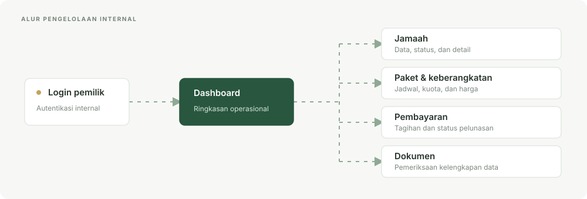

<div align="center">
  

  <h1>HajiKu</h1>
  <p><strong>Panel operasional internal untuk pemilik usaha umrah dan haji.</strong></p>

  <p>
    
    
    
    
    
  </p>
</div>

## Tentang

HajiKu adalah dashboard kerja **khusus pemilik/operator**, bukan website pendaftaran publik. Aplikasi membantu mengelola data jamaah dan aktivitas operasional dari satu panel.

## Alur kerja

Garis bergerak menunjukkan alur dari login pemilik ke area pengelolaan. Pilih menu di dashboard untuk membuka tiap modul.

<p align="center">
  
</p>

## Modul

| Modul | Fungsi |
| --- | --- |
| Ringkasan | Melihat jumlah jamaah berdasarkan status pendaftaran dan pendaftaran terbaru. |
| Jamaah | Mencari, memfilter, melihat detail, dan memperbarui status jamaah. |
| Paket & keberangkatan | Melihat paket dan menambahkan jadwal, durasi, kuota, serta harga. |
| Pembayaran | Melihat total, terbayar, dan sisa pembayaran; memperbarui status serta mengekspor CSV. |
| Dokumen | Melihat berkas unggahan tiap jamaah dari detail atau tabel dokumen, lalu memperbarui status pemeriksaan. |

Formulir pendaftaran menerima beberapa file PDF, JPG, PNG, atau WEBP hingga 10 MB per file. Berkas bisa dibuka atau diunduh dari detail jamaah.

## Menjalankan lokal

**Prasyarat:** Node.js 20.19+ atau 22.12+.

```bash
npm install
npm run dev
```

Perintah lainnya:

```bash
npm run lint
npm run build
npm run preview
```

Login prototype:

- Email: `owner@hajiku.id`
- Kata sandi: `hajiku-demo`

## Konfigurasi environment

Salin `.env.example` menjadi `.env`, lalu isi variabel **di lingkungan server**:

| Variabel | Kegunaan |
| --- | --- |
| `DATABASE_URL` | URL koneksi Neon pooled untuk aplikasi server. |
| `DATABASE_URL_UNPOOLED` | URL koneksi langsung, biasanya untuk migrasi. |
| `AUTH_SECRET` | Kunci acak untuk autentikasi server-side. Jangan commit nilainya. |

Jangan beri prefix `VITE_` pada kredensial database atau secret karena variabel `VITE_*` dapat masuk ke bundle browser.

## Deploy ke Vercel

Untuk frontend Vite, gunakan:

- Framework preset: **Vite**
- Build command: `npm run build`
- Output directory: `dist`

Tambahkan environment variables melalui **Vercel → Project Settings → Environment Variables**. Jangan menyalin `.env` ke GitHub.

## Status dan keamanan

> **Prototype:** login saat ini diperiksa di frontend dan data operasional, termasuk berkas yang dipilih, hanya tersimpan sementara di memori browser. Berkas tidak dikirim ke server dan hilang saat halaman dimuat ulang. Neon sudah dapat diakses dari tool database eksternal, tetapi aplikasi ini belum memakai API/backend untuk membaca atau menyimpan data ke Neon.

Jangan gunakan login demo untuk melindungi data sungguhan. Sebelum dipakai operasional, hubungkan frontend ke backend, pindahkan autentikasi ke server, simpan password sebagai hash menggunakan algoritma yang sama dengan backend, dan batasi akses database ke server saja.

## Struktur utama

```text
src/
├── assets/                 # Logo HajiKu
├── components/
│   ├── AdminDashboard.jsx  # Ringkasan dan pengelolaan jamaah
│   ├── DetailModal.jsx     # Pratinjau data jamaah
│   ├── LoginPage.jsx       # Login prototype pemilik
│   ├── Navbar.jsx          # Navigasi modul dan aksi pemilik
│   ├── OwnerManagement.jsx # Paket, pembayaran, dan dokumen
│   └── RegistrationForm.jsx
├── data/                   # Data simulasi dan akun demo
├── App.jsx
└── index.css
public/
└── brandlogo.png           # Favicon HajiKu
docs/
└── hajiku-flow.svg         # Diagram alur dashboard
```

---

<div align="center">
  <strong>Dafa Ardianto | Web &amp; Mobile Developer</strong>
  <br />
  <sub>Dibuat untuk membantu operasional HajiKu lebih teratur.</sub>
</div>
